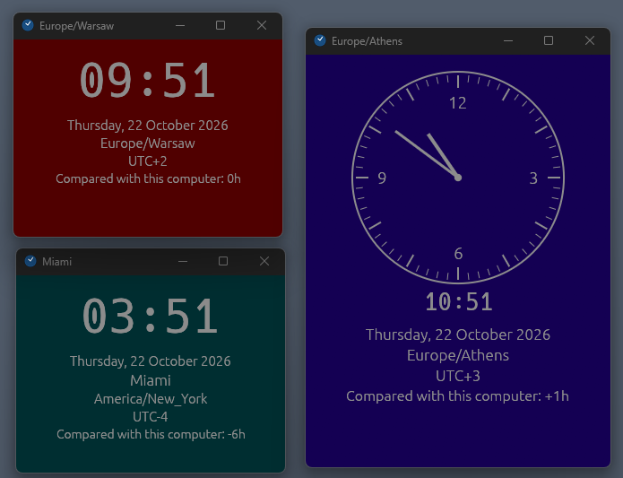
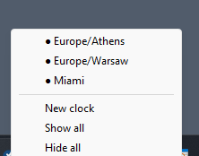
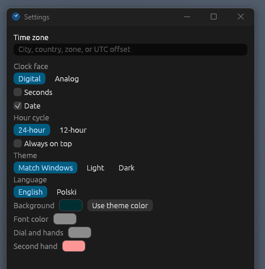

# Clocks

A small Windows desktop clock you can keep on the desk. Open one window for the time where you are, then add more for other cities. Each clock is its own window, and they all share a single icon in the notification area.



A new clock starts in this computer's time zone. It shows a large digital time, the date, the zone name, the UTC offset, and how far that zone is from this computer. A positive difference means the clock is ahead (`+1h`). `0h` means it matches this computer.

The window title is the city when you picked one, otherwise the time zone name (for example `Europe/Warsaw`).

## Run

You need [Rust](https://rustup.rs/) on Windows.

```bash
cargo run
```

A release build:

```bash
cargo build --release
```

The program is `target\release\clocks.exe`.

The interface follows the Windows display language: Polish if Windows is set to Polish, English otherwise. You can switch a clock later in its settings.

## Open another clock

Right-click a clock and choose **New clock**, or open the tray menu and choose **New clock**.



Each new clock is another window, offset a little from the previous one, again set to this computer's time zone. Change the zone from that clock's settings.

## Tray icon

Every running clock shares one tray icon. Left-click or right-click it to open the menu.

- A filled mark (`●`) means that clock is on screen. An empty mark (`○`) means it is hidden. Click a name to show or hide that window.
- **Show all** brings every clock back.
- **Hide all** hides every clock. The tray icon stays, so you can bring them back.

Minimizing a clock hides it the same way. It does not sit on the taskbar. Close the window with the title-bar button to quit that clock. When the last clock closes, the tray icon goes away too.

## Change a clock

Right-click the clock face.

- **Clock type** switches between **Digital** and **Analog**. The analog face still shows a small digital time under the dial. Switching face also resizes the window.
- **Settings** opens the settings window.
- **New clock** starts another clock.



In settings you can:

- Search for a place. Type a city, a country, an IANA zone such as `Europe/Warsaw`, or a UTC offset such as `UTC+1` or `UTC+5:30`. Press Enter to take the first match, or click a row. Results are labeled City, Country, Zone, or Offset.
- Show or hide seconds and the date.
- Choose a 24-hour or 12-hour clock.
- Keep the window always on top.
- Set the theme to match Windows, or force light or dark.
- Set the language to English or Polish. That clock's menus follow the choice.
- Pick a background, font color, dial and hands color, and second-hand color. Each color can be set back to the automatic one.

Settings last only while that clock is open. Closing it forgets them.
